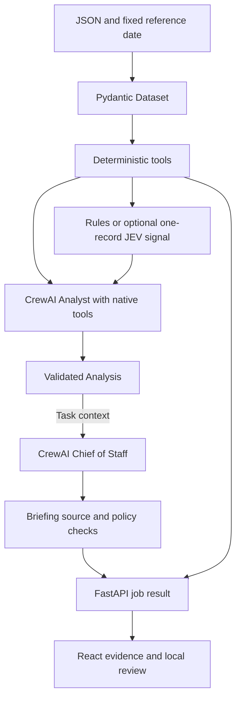

# Architecture

Praxis is a local, single-user React dashboard with a small FastAPI seam into
the existing Python application. All operational data is synthetic.

## Responsibilities

`data/` loads JSON. `schemas.py` rejects duplicate IDs, broken links, invalid
dates/money and conflicting authoritative contracts. IDs are preassigned stable
identifiers; dates are calendar dates and money is Decimal. Missing is not zero.
The default school seed uses 2026-10-30 and INR-denominated fictional programme
agreements. The preserved startup and original datasets use 2026-10-29. Each
dataset has its own metric cohorts and decision-cache fingerprint. Public YFS
programmes inform the school scenario; no internal school records are used.

`tools/` retrieves records, calculates metrics, detects deadlines and applies
mandatory escalation. Typed results contain source IDs. The compact operating
snapshot preserves descriptions, related IDs, financial fields and missingness.
It invokes the focused functions; nested events represent real executions within
one model-requested tool call. Actor attribution distinguishes application
preflight, agent tools and output validation.

`decisions/` implements `DecisionProvider.evaluate(record) -> DecisionResult`.
Rules map categories to teams and deadlines/policy to bounded urgency. They have
no probability semantics. JEV batches choice, ordered score and noul questions
for one selected record; remaining records explicitly use rules. The returned
fractional expected score remains distinct from the winning urgency tier.
Probability/confidence metadata is retained only where the provider defines it.
JEV never calculates revenue or writes the briefing.

JEV uses the pinned documented model, 10-second request timeouts, at most three
attempts with backoff and a shared per-evaluation idempotency key. Permanent and
spend-limit failures do not retry; long wait hints stop without early retry. A
matching validated response cache avoids spending again across views/restarts.
Process locking prevents same-process concurrent duplicate evaluations. This is
not a distributed cache or cross-process lock; run only one backend instance.
Cache provenance includes response, model version, request ID and timestamp.
Bad cache entries fail closed. No error is silently replaced with rules.

`agents/` creates exactly two native agents with `Process.sequential`.
The Analyst owns business tools. The Chief owns no tools and receives
`context=[analysis_task]` after the Pydantic/guardrail handoff. Delegation, code
execution, persistent memory and tracing exports are disabled. Before accepting
that handoff, the Analyst task also checks that every mandatory incident finding
carries its required agreement sources. Missing sources receive explicit ID
feedback within the existing bounded retry; no evidence is silently appended.
Iterations, provider output and request timeouts are bounded; these are per-step bounds,
not a guarantee of total wall-clock duration. Groq uses its own native-compatible
transport, separates tool calls from structured final output and retains the
namespaced model ID. Structured replies use JSON object mode and the same local
Pydantic model/guardrails: Groq's schema-constrained decoder repeatedly returned
empty generation errors during verification. The output cap is 4000 tokens.
It can still wait or fail on free-tier limits.

`validation/` checks real retrieval, declared source scope, category/status,
rank consistency, completed exclusions and mandatory priorities. Record IDs in
prose must belong to the claim's allowed evidence. The Chief may carry forward
explicitly validated Analyst limitations about retrieved records; this does not
make those records eligible for priority claims. Numeric prose claims are
rejected; actual dates and amounts are rendered from deterministic fields.
Prompts require conditional outcomes and explicit assumptions. These checks do
not establish general semantic entailment or eliminate all prompt injection.

`services/briefing.py` coordinates deterministic preflight, decisions, actual
CrewAI execution and final acceptance. Failure withholds the briefing and retains
safe execution metadata. Provider bodies/secrets are not presented or logged.

`api.py` exposes health, validated overview/records, one-record decisions, and
background briefing jobs. One worker and an active-job check bound concurrency.
Up to 20 jobs are retained in memory; restarting loses them. Only loopback launch
and frontend development origins are configured. No authentication or mutation
endpoints are added. The compiled frontend can be served by this same process.

`frontend/src/App.tsx` presents facts, labeled model judgments, proposals, evidence,
and recorded events. Dataset changes clear results/reviews; inputs cannot change
datasets during pending submissions/evaluations/runs. Transient polling errors
retain the job ID and retry polling; a missing job after restart is explicit.
The native dialog provides source inspection. Approvals exist only in React
state and reset per run/page session. No outbound approval request exists.
`app.py` retains the original Streamlit rules-only interface.

## Metrics and policy

All metrics are counts/sums with explicit eligible source cohorts, not rates.

| Metric | Eligibility |
|---|---|
| Contract exposure | Distinct active authoritative contracts directly linked to active support/cancellation; missing values excluded and listed; totals by currency |
| Potential pipeline | Recorded deal values on active sales records; each is a distinct opportunity |
| Open issues | Active support/cancellation/product/operations/finance records |
| Overdue tasks | Active product/operations/finance deadlines strictly before reference date |
| Customer escalations | Active support/cancellation records, not unique customers |
| Opportunities | Active sales records |

Active means open or blocked. No FX conversion, expected-loss calculation or
realized-revenue inference occurs. Linked incident values do not double count
their authoritative contract. A critical active support incident linked to an
active contract due within seven days, including overdue, must lead at Critical
with both sources cited. Conflicting recovery notes do not close that incident.

## Reliability limits

The synthetic ten-case fixture is regression evidence, not an independent model
benchmark. One-record JEV comparison is deliberately budget-limited; there is no
bulk accuracy/cost/speed claim. Cached live output is labeled historical reuse,
never a new model execution. Browser visual rehearsal remains distinct from
compiler, DOM interaction, mocked integration and live provider tests.
